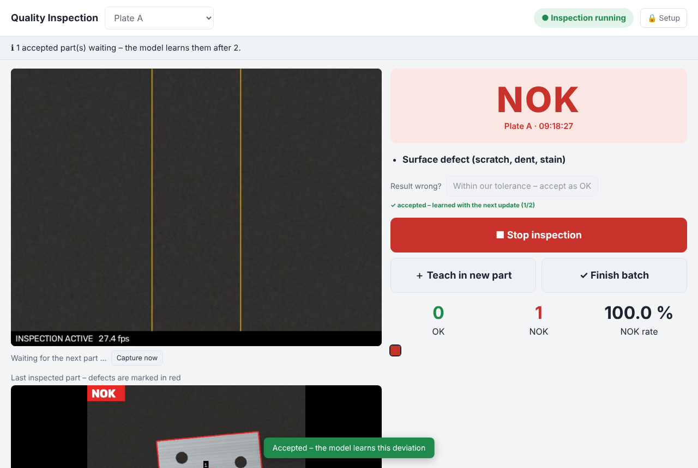

# Project 1 – AI-assisted quality inspection of metal parts

Camera-based OK/NOK inspection of metal parts on a conveyor belt, running on a Raspberry Pi. A part type is
taught in with 10–20 **good parts** – no defect examples and no predefined defect categories are needed. New
parts are then inspected with a combination of classical image processing (OpenCV), a reference image
comparison and unsupervised machine learning; for NOK parts the defect is named and marked in the image.



**Version 2 – core version.** Compared with version 1 (the full version) the project was reduced to what the
task needs and restructured. Removed: dual light (back + front light), self-learning during operation,
reference part self-test, GPIO outputs and the checkerboard calibration (replaced by one scale value,
`camera.mm_per_px`). The inspection itself is unchanged – checked with a golden-master comparison of 250 parts
(identical OK/NOK decisions, defect types and reference screening). A `config.json` or a single-light model of the
full version still loads; removed config sections are ignored with a notice.

**Version 2.1 – continuous improvement.** The operator adapts the model to the real conditions in operation: a NOK
part that is still within the company's tolerance is accepted with one button, and the model learns this deviation –
locally, under a release check, with versions and undo. See [Continuous improvement](#continuous-improvement).

## Two levels of operation

| | Who | What |
|---|---|---|
| **Operator screen** (default, no PIN) | Supervisor at the conveyor | Select part · Start/Stop · big OK/NOK with the defect in plain words · *Teach in new part* (assistant) · *Finish batch* (ZIP + reset) · “Result wrong?” → *Within our tolerance – accept as OK* / *Part is actually DEFECTIVE* |
| **Setup area** (🔒 Setup, PIN) | Setup technician | Live scores of every method and history · sensitivity per method · training report · model versions: *Update now*, accepted parts (view/discard), *Undo last update* · delete models · focus assistant · drift values · archives · log messages · simulator |

The PIN is set in `config.json → "ui": {"setup_pin": "…"}` – **change the default `1234`** (the installer asks for
one). See [Security](#security).

## Quick start (no hardware)

```bash
python3 -m venv .venv && source .venv/bin/activate
pip install -e ".[dev]"
qc web                     # → http://localhost:8000  (same as: python main.py web)
```

The simulator generates a conveyor with synthetic plates. On the operator screen:

1. **＋ Teach in new part** → enter a name → *Next*. Good parts run over the conveyor and are captured
   automatically in the middle of the picture (tap a thumbnail to remove a wrong capture). After 15 parts the
   model is created by itself (*Finish now* is possible from 3 parts).
2. **▶ Start inspection**. The result appears big (OK/NOK); for NOK the defect is named and marked in the picture.
3. **✓ Finish batch** at the end: all results are saved as a ZIP file and the counters are reset.

## Inspection pipeline

```
Camera image
  → Trigger: part completely visible and in the image centre?          (trigger.py)
  → Localisation: Otsu threshold, largest object completely in the image (rails and belt edges that run out
    of the image are ignored), minAreaRect                              (alignment.py)
  → Alignment: centroid onto a fixed canvas, 360° rotation search against
    the reference (decided by the hole pattern), ECC fine alignment (sub-pixel)
  → Photometric normalisation: background = 0, part = 1
  → Inspection methods                                                   (methods.py)
       geometry  holes + outline vs. learned nominal geometry (sub-pixel)
       diff      z-score difference map vs. mean/spread image of the good parts
       pca       ML: PCA subspace of the good parts, reconstruction error = anomaly
  → Decision: fusion of the methods, × sensitivity per method           (model.py)
  → 3 images per part → majority vote (2nd/3rd only if the 1st is not clearly good)   (inspection.py)
  → OK / NOK + defect type + marking in the image                       (visualize.py)
  → history, CSV log, NOK images, drift monitor                         (results.py, drift.py)
```

| Defect | Detected by | Reported as |
|---|---|---|
| missing hole | geometry | Hole missing |
| hole not drilled through | geometry (edge ring at the nominal place, but no see-through) | Hole not drilled through |
| mispositioned hole | geometry (Hungarian matching, tolerance from the learning phase) | Hole mispositioned |
| wrong diameter | geometry (equivalent diameter) | Wrong hole diameter |
| wrong shape (slot/cut-out) | geometry (aspect ratio) | Wrong cut-out shape |
| extra hole | geometry | Extra hole/cut-out |
| damaged outline | geometry (mask XOR) | Outline deviation |
| scratches, discoloration, anything unexpected | diff, pca | Deviation from reference image / ML anomaly |

**Thresholds without defect examples.** Geometry tolerances come from the spread of the good parts:
max(minimum tolerance, k·σ). For `diff` and `pca`, leave-one-out measures how far each good part deviates from
the others, and the threshold is set above that with a safety margin.

**Fusion decision.** A method decides alone only above its stand-alone level (geometry/diff 1.0, ML 1.5); weaker
findings need a second method to agree. `"method": {"decision": "or"}` makes every method decide alone.

**Sensitivity per method** (setup area → Models): ×0.5 … ×2 per method and model (> 1 = stricter). It takes effect
immediately and is stored with the model.

**Multi-shot majority vote** (always on): 3 images while the part passes; random false alarms (dust, a reflection)
are outvoted. If the 1st image is clearly good (every method below 50 % of its threshold) it is final, so a clearly
good part costs one inspection and a doubtful one three. A tie counts as NOK.

### Reference screening – a defective part taught in by mistake is left out

Because the thresholds are learned from the good parts, a single defective part among them is dangerous: in a test
with 14 good parts and 1 part with an offset hole, the threshold of the image comparison rose from 30 to 858 px and
the model afterwards found **0 % of the scratches** (instead of 93 %) – without any warning. Therefore every
reference is compared with the *other* references (leave-one-out) before the model is finished:

| Method | A reference is conspicuous if … |
|---|---|
| geometry | its hole count differs, a hole lies outside the tolerance or has a wrong diameter **compared with the other references**, or its outline stands out |
| diff | its deviation area against the other references is a defect (≥ `diff_min_area_px`) and a clear outlier (median + 5 · MAD) |
| pca | same outlier rule × 1.5 (ML stand-alone level) – **only reported, never excluded**, because ML scatters more on good parts |

Conspicuous references are left out, the model is trained again without them and the setup technician gets a
warning naming the image number(s) and the reason. Safeguards: at most 25 % of the references are left out
(`screen_max_ratio`) and at least 3 must remain – if more stand out, the cause is the setup (lighting, focus,
wrong part type) and nothing is left out, only reported.

Test result (synthetic): all 7 defect types as a single wrong reference are found and left out, also two at once;
detection stays as without the bad part. 24 clean teach-ins (4 shapes, front and backlight): 0 references left
out, false alarms unchanged at 0 %. Tests: `tests/test_screening.py`.

## Continuous improvement

The model is taught in with a few good parts under one condition. In operation, conditions vary (light during the
day, a new batch of material, a slightly different jig) and the company may accept deviations that the model rates
NOK. The operator teaches the model these decisions while it is running:

```
NOK result ─► "Within our tolerance – accept as OK" ─► waiting ─► after 5 accepted parts (or "Update now"):
                                                                  new version trained in the background,
OK result  ─► "Part is actually DEFECTIVE" ─┐                    inspection continues with the current one
NOK result ─► confirmed as defective ───────┴─► test parts ─────► release check: every test part still detected?
                                                                     yes → version n+1 (version n kept, undo)
                                                                     no  → model unchanged, reason reported
```

**Learned locally, not globally.** Simply adding an accepted part as a normal reference would loosen the global
thresholds – with one part with a shifted hole the model detected 0 % instead of 93 % of the scratches (see
*Reference screening*). Therefore the nominal state is learned from the normal good parts only, and every method
stores the accepted deviation *where it is*:

| Method | Accepted deviation becomes |
|---|---|
| geometry | the minimum tolerance of **that** hole: accepted offset/diameter deviation + the normal measuring scatter (k·σ); accepted outline deviations are tolerated at their place |
| diff | a tolerance map: the accepted grey-value deviation, only where the part was conspicuous, spread over 7 px |
| pca | the same for the ML residual |

Missing, extra and blind holes stay defects in every case.

Test (synthetic, 19 good parts + 1 accepted part with a hole offset by 9 px; default tolerance 6 px):

| Parts | NOK before | NOK after |
|---|---|---|
| hole offset 8–9 px at the same hole | 100 % | **0 %** |
| hole offset 18 px | 100 % | 100 % |
| hole offset 9 px at the *other* hole | 100 % | 100 % |
| scratches | 80 % | 80 % |
| good parts | 0 % | 0 % |

An accepted surface mark is tolerated at its place in the same way; marks elsewhere stay 100 % NOK.

**Safeguards**

- The model only learns from **confirmed** decisions of the operator – never by itself.
- **Release check:** every part that was confirmed as defective (“Part is actually DEFECTIVE”, confirmed NOK
  results) and that the current version detects must still be detected by the new version. An acceptance that
  contradicts an earlier decision rejects the update; the accepted parts can be viewed and discarded in the setup
  area.
- **Versions:** every update is a new version with a history entry (accepted parts, test parts still detected,
  parts that could not be learned). *Undo last update* swaps back – and can itself be undone.
- Accepted parts are never removed by the reference screening (they deviate on purpose).
- A new teach-in of the part starts fresh (the previous model can still be restored).
- **Measurable:** the inspection and feedback logs carry the model version, and the batch summary compares the
  versions (parts, NOK, false alarms = parts the operator accepted, missed defects).

Settings: `config.json → "learning"` (`enabled`, `update_after` – 0 = only with *Update now*, `max_waiting`,
`max_known_bad`). Tests: `tests/test_learning.py`.

## Evaluation: which combination works?

```bash
qc evaluate --synthetic --md docs/evaluation_synthetic.md
qc evaluate --train images/good --test images/test    # own photos: test/ok, test/nok/<defect_type>
```

On synthetic data (15 training images, 40 good + 80 defective parts per scenario, full table in
[`docs/evaluation_synthetic.md`](docs/evaluation_synthetic.md)) the combination `geometry + diff[norm] + pca[edges]`
detects all 8 defect types under front light with 0 % false alarms; each single method covers only part of them.
Photometric normalisation beats raw grayscale (98 % vs. 82 %). Backlight gives very clean hole contours but makes
surface defects invisible.

> **Important:** the synthetic defects are pronounced and self-modelled. The 100 % values only show that the
> pipeline works, not how well it performs on real parts. Repeat the evaluation with real photos, including
> borderline defects: small offsets, slightly wrong diameters, fine scratches.

## Teaching a new part type

Outline, hole count, hole positions and sizes are all learned from the good parts – a triangle with 3 holes, a
square with 4 holes, an L-bracket or a disc is taught in exactly like a rectangular plate. The alignment searches the
full 360° and decides between look-alike rotations by the hole pattern, so parts may arrive in any rotation.

| Requirement | Why |
|---|---|
| Clear contrast between the part and the belt (or backlight) | The part is found with an automatic threshold. Shiny metal on a matt dark belt, or backlight, works well. |
| Part completely in the image, same camera height as when learning | Everything is measured in pixels; a different distance changes all dimensions. |
| Flat part lying on the belt | The method is 2D. Parts that can lie on different sides need their own model per resting position. |
| Holes are through holes | Only then are they detected as holes. Blind holes are recognised by their edge (front light). |
| 10–20 good parts, each placed slightly differently | The system learns the normal variation from them. |
| Holes at least ~6 px in diameter in the image | Smaller holes are filtered as noise (`hole_min_area_px`). |

**Parts lying upside down** are a mirror image and rated NOK by default (it may be a left/right variant).
`"localization": {"allow_mirror": true}` accepts them.

## Automatic camera setup

When a new part type is taught in, the camera adjusts itself; the operator only lays one good part under the camera
and lets the parts run.

| Step | What the software does |
|---|---|
| 1 · One good part lies still → *Adjust camera automatically* | White balance (locked), exposure (brightest pixels ≈ 225 of 255, gain 1.0), autofocus on the part for cameras with a focus motor, sharpness check for cameras without one, size and position of the part. |
| 2 · Start the belt; the **first part** runs through (not counted) | Belt direction and speed → exposure short enough for ≤ 0.5 px motion blur; **digital zoom** onto the part's path (up to 2.5×, every measurement gets finer). |
| 3 · The other good parts run | Teach-in as usual; the sharpness of every reference is measured. |
| Afterwards | All settings are stored **with the model** and applied whenever this part type is selected. |

**Camera turned by 90°** (belt runs top ↕ bottom in the image): setup area → *Setup* → *Camera & focus* →
*Belt direction* – the trigger lines turn with it; saved in `config.json` (`"trigger": {"axis": "y"}`).

Stays manual: the lens of a camera **without** focus motor (Camera Module v2, HQ) – focus it once with the **focus
assistant** (setup area → *Setup* → *Camera & focus*); camera mount and lighting. Settings: `config.json →
"autosetup"`.

**Dimensions in mm:** OK/NOK needs no calibration (tolerances are learned from the good parts). For defect texts in
mm, set `"camera": {"mm_per_px": …}` = length of a part in mm / its length in px in the working image at the full
field of view; the zoom of a part type is taken into account automatically. Absolute tolerances from the drawing:
`"method": {"pos_tol_mm": 0.3, "dia_tol_mm": 0.15}`.

## Running on the Raspberry Pi

**Installation (once)** – Raspberry Pi OS (Bookworm or newer), project unzipped e.g. to `~/pi_qc`. Step-by-step
guide in German: [`docs/INSTALL.de.md`](docs/INSTALL.de.md).

```bash
cd ~/pi_qc
bash deploy/install.sh                  # with autostart
bash deploy/install.sh --no-autostart   # start by hand
bash deploy/install.sh --no-camera      # laptop: simulator / image folders only
```

The script works **with or without sudo rights** and can be run again at any time:

| Step | with sudo | without sudo |
|---|---|---|
| Camera library `picamera2` | installed via apt | must be present (pre-installed on Raspberry Pi OS) |
| OpenCV, SciPy, Flask, waitress | installed via apt | installed into `.venv` with pip – ready-made packages only; NumPy stays the system version |
| Python environment `.venv` | with access to the system packages (`--system-site-packages`) | same |
| `config.json` | from the Pi 3 + Camera Module v2 preset, asks for the setup PIN | same |
| Autostart (unless `--no-autostart`) | system service `qc` | user service `qc` (fallback: `crontab @reboot`) |

**Why the system NumPy:** `picamera2` comes from apt and is built for the NumPy of the operating system – NumPy 1.x on
Raspberry Pi OS Bookworm (Python 3.11), NumPy 2.x on Trixie (Python 3.13). A different NumPy major version in the
environment breaks the camera, and a fixed limit such as `numpy<2` cannot be installed on Trixie at all (there is no
NumPy 1.x for Python 3.13). The installer therefore pins `numpy==<system version>`, so pip only picks OpenCV/SciPy
versions that fit it. By hand: `.venv/bin/pip install -e . "numpy==$(python3 -c 'import numpy; print(numpy.__version__)')"`.

**Updating** (keeps models, results, configuration and the Python environment):

```bash
systemctl --user stop qc 2>/dev/null; sudo systemctl stop qc 2>/dev/null   # whichever autostart is used
mv ~/pi_qc ~/pi_qc_old                                       # keep the old version as a backup
unzip EdgeAi_v2.1.2.zip -d ~                                  # → ~/pi_qc (same path, so the autostart still works)
mv ~/pi_qc_old/data ~/pi_qc_old/config.json ~/pi_qc_old/.venv ~/pi_qc/
cd ~/pi_qc && bash deploy/install.sh --no-autostart          # installs what the new version needs
```

Models of older versions keep working; teaching them in again is recommended (reference screening, learned
tolerances). The start-up log lists config sections of version 1 that are now ignored (e.g. `self_learning`).

| Task | with sudo | without sudo |
|---|---|---|
| Restart after a configuration change | `sudo systemctl restart qc` | `systemctl --user restart qc` |
| Live log / errors | `journalctl -u qc -f` | `journalctl --user -u qc -f` |
| Start by hand (stop the service first) | `.venv/bin/python main.py web --camera pi` | same |
| Camera test (service stopped) | `rpicam-hello --list-cameras` | same |
| Time per processing step | `.venv/bin/python main.py benchmark` | same |

The log file `data/logs/qc.log` is written in every case.

### Raspberry Pi 3 Model B + Camera Module v2 (IMX219)

| Setting (`config.pi3_imx219.json`) | Value | Why |
|---|---|---|
| `camera.sensor_mode` | `[1640, 1232]` | 2×2-binned readout of the **full** sensor. Without it libcamera may pick 1920×1080, which on the IMX219 is a **crop** of the image centre. |
| `camera.width/height` | 640 × 480 | The camera's ISP scales to the working resolution for free. |
| `camera.fps` | 15 | Fewer frames to copy and check on the Pi 3. |
| `camera.exposure_us` | 2000 | Short against motion blur (50 mm/s × 2 ms = 0.1 mm). Needs bright, constant light. |
| `trigger.detect_width` | 240 | Part detection for the trigger on a smaller image. |
| `ui.preview_fps` | 5 | The live image costs CPU. |

Hardware notes: focus the v2 lens by hand (factory setting is far distance); the **rolling shutter** shears moving
parts (≈ 24 ms readout) – identical for references and inspected parts at the same constant belt speed, so keep the
belt speed constant between teach-in and inspection; run the browser on another device; use a 5.1 V / 2.5 A supply.

## Security

| Measure | Details |
|---|---|
| Setup PIN, checked on the server | Session token after unlocking, expires after 30 min without setup activity (`ui.setup_timeout_min`). |
| Brute-force protection per device | 5 wrong PINs block **that** device for 60 s – an attacker cannot lock out the technician on another device. |
| CSRF protection | Every modifying request needs the header `X-QC-Client` (OWASP *custom request header* defence): a foreign web page in the operator's browser cannot trigger actions. |
| Security headers | `Content-Security-Policy` (own scripts only), `X-Frame-Options: DENY`, `X-Content-Type-Options: nosniff`, `Referrer-Policy`, `Cache-Control: no-store` for the API. |
| Path traversal | Model, archive and accepted-part names are resolved and checked against their folder. |
| Model changes need the PIN | Update now, undo, viewing/discarding accepted parts and deleting models are setup functions. The operator can only *propose* (accept a part); the release check guards every update. |
| Optional network token | Environment variable `QC_TOKEN` – all modifying requests need it; open the page with `?token=…`. |

**Known limits (by design for a student project):** the operator level has no login and the server speaks plain
HTTP – anyone on the same network can start/stop the inspection or teach in a part. Run it on an isolated network
(or set `QC_TOKEN`); for production use, add HTTPS (reverse proxy) and user accounts.

## Robustness

| Feature | What it does |
|---|---|
| Inspection queue | The camera thread only captures; a worker thread inspects outside the lock, so the live view, trigger and web UI keep running while the Pi inspects. If more than 3 parts wait, the next part is **logged as not inspected** (`NOT_INSPECTED` in the log and the batch summary) and the operator screen says so. |
| Drift monitor | Contrast, background, part size and edge sharpness vs. the learning phase; plain-language hint if lighting, camera distance or focus change. |
| Configuration check | Typos (`"exposure"` instead of `"exposure_us"`) and invalid values stop the start with a clear message. |
| Atomic model saving | A model is written to a temporary folder and swapped in one step – the UI never sees a half-written model. |
| Log file | `data/logs/qc.log` (3 × 1 MB rotating), also errors from the background threads. |

## Data storage

```
data/models/<name>/     meta.json (settings, sensitivity, camera profile, version + history, training report),
                        arrays.npz, refs/*.png, pending/ (accepted parts waiting), known_bad/ (test parts),
                        previous/ (the version before the last update)
data/results/<date>/    inspection_log.csv, feedback_log.csv, NOK images (marked + original)
data/archive/*.zip      finished batches (results + summary.txt/summary.json)
data/logs/qc.log        log file
```

## Project structure

```
main.py                    entry point (python main.py …) – the commands are in qc/cli.py
pyproject.toml             dependencies and tool settings (pytest, coverage, ruff, mypy)
.github/workflows/ci.yml   CI: format, lint, types and tests on every push to main and every pull request
qc/config.py               all parameters (dataclasses, overridable via config.json, validated)
qc/camera.py               Pi camera, USB, image folder, simulator
qc/trigger.py              conveyor trigger (one capture per part)
qc/alignment.py            localisation, alignment, photometric normalisation
qc/representations.py      image representations (gray, CLAHE, edges, threshold, LAB, HSV …)
qc/methods.py              inspection methods geometry / diff / pca, reference screening per method
qc/model.py                part type: training (with screening), inspection, fusion decision, save/load
qc/inspection.py           several images per part, majority vote
qc/visualize.py            defect marking, heatmap
qc/teach.py                teach-in session (reference images)
qc/camera_setup.py         camera profiles, automatic camera setup, focus assistant
qc/autosetup.py            calculations of the automatic camera setup (exposure, zoom, sharpness, belt path)
qc/results.py              history, counters, supervisor feedback, CSV logs
qc/learning.py             continuous improvement: accepted parts, model update with release check
qc/improvement.py          continuous improvement in operation: operator decisions → background update, undo
qc/drift.py                image-quality drift monitor
qc/archive.py              ZIP + summary of finished batches
qc/system.py               coordination: threads, operating mode, components above
qc/web/                    web UI: operator_api.py and setup_api.py (Flask blueprints), auth.py, static/
qc/synthetic.py            synthetic parts with defects (simulator, tests)
qc/evaluate.py             comparison of method × representation × lighting
deploy/                    install.sh (installation + autostart), run.sh
tests/                     pytest – 77 tests, incl. complete web workflows with the simulator and a
                           stand-in for picamera2 to test the Pi camera code
```

## Development and code standards

| Standard | Tool | Command | Status |
|---|---|---|---|
| PEP 8 formatting | ruff format (Black style, 120 characters) | `ruff format qc tests main.py` | ✓ all files |
| PEP 8 + bug patterns, import order, naming, complexity ≤ 15 | ruff (pycodestyle, pyflakes, bugbear, mccabe …) | `ruff check qc tests main.py` | ✓ 0 findings |
| PEP 484 type hints | mypy | `mypy` | ✓ 0 errors |
| PEP 257 docstrings | – | – | modules and public functions |
| PEP 621 project metadata | pyproject.toml | `pip install -e ".[dev]"` | ✓ |
| Tests + coverage | pytest, pytest-cov, pytest-xdist (parallel) | `pytest --cov` | ✓ 77 tests, 94 %, ~45 s |
| Continuous integration | GitHub Actions, Python 3.11 + 3.13 | `.github/workflows/ci.yml` | all rows above on every pull request |

All rules are configured in `pyproject.toml`; the exceptions are commented there (e.g. upper-case `H, W, K` for
matrices in image processing, and `int(round(x))`, which is needed with NumPy 1.x on Raspberry Pi OS Bookworm).
The tests run in parallel (one process per CPU core); `pytest -n 0` runs them one after another, e.g. for debugging.

Design principles: **one responsibility per module** (the former 700-line `QCSystem` with three mixins is now a
coordinator plus small components), **composition instead of mixins**, **pure functions where possible**
(`vote`, `decide`, `autosetup`) because they are easy to test, and **KISS/YAGNI** – features that the task does not
need were removed instead of being kept "just in case".
